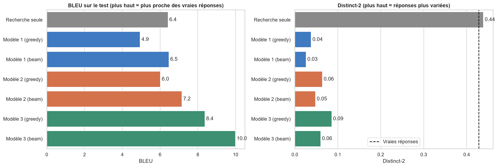

# 🏦 SupportBot

Chatbot de service client basé sur un encodeur–décodeur LSTM avec attention,
construit et entraîné from scratch avec PyTorch, augmenté par une recherche TF-IDF
inspirée du raisonnement à partir de cas (CBR).

🚧 Projet en cours de développement.
## Avancement

- [x] Contrôle qualité des données
- [x] Construction des paires message → réponse
- [x] Nettoyage du texte
- [x] Vocabulaire et représentation numérique
- [x] Modèle 1 : encodeur–décodeur LSTM (sans attention)
- [x] Modèle 2 : encodeur–décodeur LSTM avec attention
- [x] Génération (greedy et beam search)
- [x] Modèle 3 : attention + recherche TF-IDF (RAG)
- [x] Évaluation et comparaison des trois modèles
- [ ] Application Streamlit
- [ ] Rapport et présentation


## Résultats

Évaluation sur l'ensemble de test (perplexité sur 15 000 paires, BLEU et Distinct-2 sur
1 000 messages, génération par beam search) :

| Système | Perplexité | BLEU | Distinct-2 |
|---|---|---|---|
| Modèle 1 : LSTM | 12,72 | 6,47 | 0,026 |
| Modèle 2 : LSTM + attention | 11,47 | 7,16 | 0,048 |
| Modèle 3 : LSTM + attention + cas similaire (RAG) | **10,71** | **9,99** | **0,060** |
| Recherche seule | — | 6,42 | 0,439 |



## Application

Une application Streamlit permet de discuter avec le chatbot : choix de la marque, du modèle
(1, 2 ou 3) et de la méthode de génération, affichage du cas similaire retrouvé et de la carte
d'attention.

1. Exécuter le notebook `notebooks/02_modele.ipynb` jusqu'à la section 14, qui exporte les
   modèles dans `app/ressources/`.
2. Depuis la racine du projet :

    ```bash
    conda activate supportbot
    streamlit run app/app.py
    ```